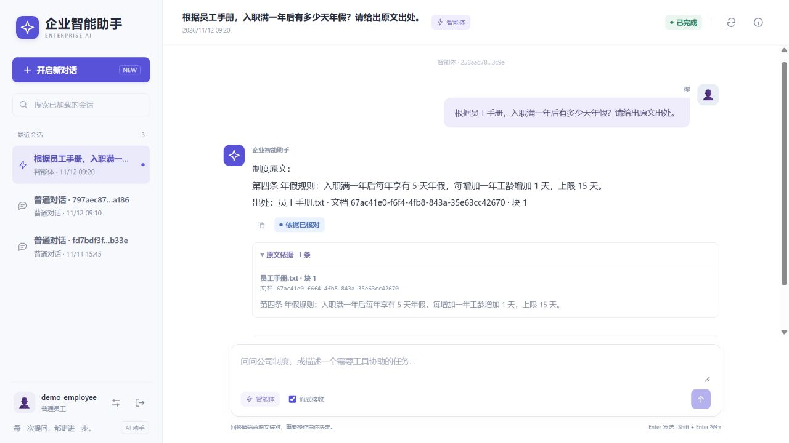
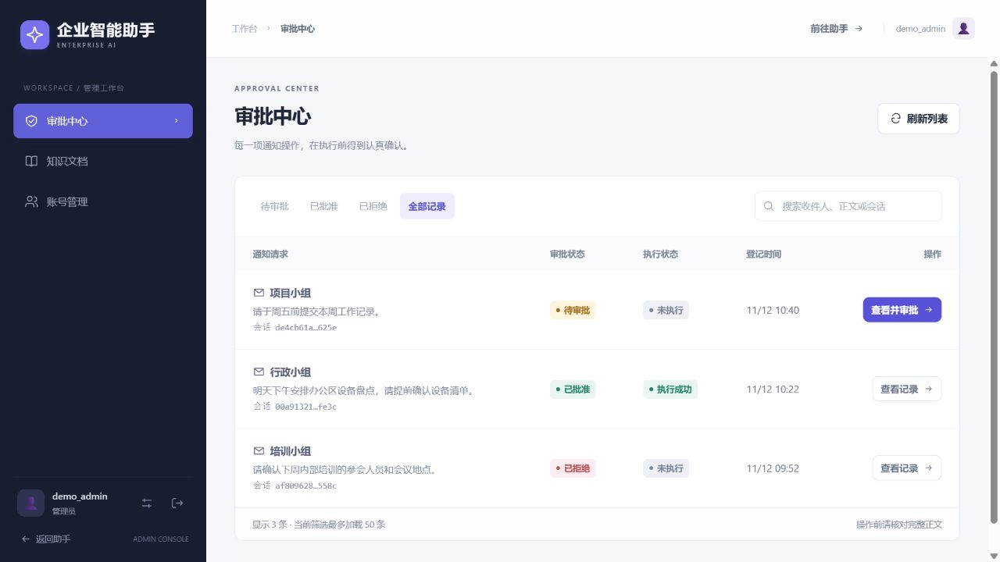
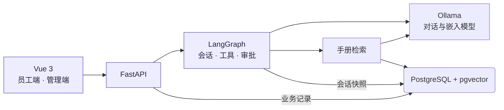

<h1 align="center">企业智能助手</h1>

<p align="center"><strong>面向企业制度查询与日常协作的本地 Web 应用</strong></p>

<p align="center">
  
  
  
  
  
</p>

<p align="center">
  <a href="#features">核心功能</a> ·
  <a href="#preview">界面预览</a> ·
  <a href="#quick-start">快速开始</a> ·
  <a href="#examples">使用示例</a> ·
  <a href="#architecture">系统架构</a> ·
  <a href="#structure">项目结构</a>
</p>

员工可以在工作台进行多轮对话、查阅手册条款、根据查到的资料进行计算，也可以发起模拟通知。管理员可以维护知识文档和账号，在审批中心核对通知内容、处理请求并查询执行结果。

<a name="features"></a>

## 核心功能

| 功能 | 可以做什么 |
| --- | --- |
| **多轮对话** | 创建或切换会话，继续上一次的话题。普通对话支持通过 SSE 流式查看回复。 |
| **知识库问答** | 在智能体会话中查询已入库的制度。回答展示可核对的原文、文件名、文档 ID 和块编号，缺少依据时提示资料不足。 |
| **工具协作** | 让智能体先查制度，再调用加法或乘法工具处理金额和数量。 |
| **通知审批** | 智能体发起模拟通知后暂停，管理员核对收件人和正文。批准后恢复执行模拟通知，拒绝后结束该操作。 |
| **管理后台** | 上传或删除知识文档，调整账号角色和启用状态，查看审批决定与执行结果。 |

<a name="preview"></a>

## 界面预览

以下界面使用示例数据。

### 员工端 · 制度问答



### 管理后台 · 审批中心



<a name="quick-start"></a>

## 快速开始

需要 **Python 3.12 或更高版本**、**uv**、**Docker 和 Docker Compose**、**Ollama**。以下命令在项目根目录的 PowerShell 中执行。

### 1. 安装依赖并准备配置

```powershell
uv sync --locked

if (-not (Test-Path -LiteralPath '.env')) {
    Copy-Item -LiteralPath '.env.example' -Destination '.env'
}
if (-not (Test-Path -LiteralPath '.\infra\postgres\.env.db')) {
    Copy-Item -LiteralPath '.\infra\postgres\.env.db.example' -Destination '.\infra\postgres\.env.db'
}
```

首次配置时，填写 `infra/postgres/.env.db` 中的 `POSTGRES_PASSWORD`。连接已有数据库时请填写该数据库当前使用的密码。

在 `.env` 中设置独立的 `API_JWT_SECRET`。可以用下面的命令生成随机值，再复制进去。首次启动可设置 `RERANK_MODE=off`，直接使用向量与关键词混合检索（`RETRIEVAL_MODE=hybrid`）。

```powershell
uv run python -c "import secrets; print(secrets.token_urlsafe(48))"
```

### 2. 启动数据库并准备模型

启动 Docker 和 Ollama，执行以下命令。已下载的模型可直接使用。

```powershell
docker compose -f '.\infra\postgres\compose.yaml' up -d --wait --wait-timeout 120
ollama pull qwen2.5:7b
ollama pull bge-m3
```

### 3. 初始化并运行应用

在新数据库上执行 `setup`。首次创建管理员时，`bootstrap-admin` 会提示输入并确认密码。已有管理员可直接登录。

```powershell
uv run python -m app.manage setup
uv run python -m app.manage bootstrap-admin --username assistant_admin
uv run python -m app.manage doctor
uv run python -m app.manage serve
```

| 入口 | 地址 |
| --- | --- |
| 员工端 | [http://127.0.0.1:8000/](http://127.0.0.1:8000/) |
| 管理后台 | [http://127.0.0.1:8000/admin](http://127.0.0.1:8000/admin) |
| API 文档 | [http://127.0.0.1:8000/docs](http://127.0.0.1:8000/docs) |

<a name="examples"></a>

## 使用示例

### 查制度和计算金额

管理员在「知识文档」上传仓库自带的 [员工手册.txt](data/员工手册.txt)。文档支持 UTF-8 编码的 `.txt` 和 `.md`，单个文件最大 5 MiB。

员工登录后选择「开启新对话」→「智能体」，可以直接复制下面的一条提问。

> 根据员工手册，入职满一年后的年假是多少天？请给出对应原文。

> 先查员工手册中住房补贴的每月金额，再调用乘法工具计算 3 个月的合计。假设三个月都符合申领条件，请给出制度原文和计算结果。

### 发起与处理模拟通知

在「智能体」会话中输入下面这条请求。

> 请向测试收件人发起一条模拟通知，正文为“请于周五前提交本周工作记录。”

管理员在「审批中心」选择「批准并执行」或「拒绝」。员工在原会话点击「只读刷新」，即可查看处理结果。通知工具在本地生成模拟结果，审批决定和执行结果保存在数据库中。

<a name="architecture"></a>

## 系统架构



- **检索增强生成（RAG）** · 文档入库时切分文本并用 `bge-m3` 生成向量。混合检索用 pgvector 按余弦距离查找语义相关片段，同时用 BM25 做关键词召回，再用 RRF 融合两路排序。可选本地 BGE 重排。展示引用前，服务端核对引用文字是否出现在对应的原文片段中。
- **状态与审批** · LangGraph 通过 `PostgresSaver` 保存会话快照。服务重启后可以读取历史，并从保存的状态继续待审批流程。消息、审批决定和执行结果有对应的业务记录。
- **身份与重复提交** · FastAPI 校验 JWT、用户角色和会话归属。在同一会话中，重复提交相同请求 ID 和内容时，服务端复用已完成的结果。使用相同请求 ID 提交不同内容会返回冲突。

## 配置参考

应用与数据库的配置模板分别为 [`.env.example`](.env.example) 和 [`.env.db.example`](infra/postgres/.env.db.example)。

| 参数 | 用途 |
| --- | --- |
| `OLLAMA_BASE_URL` | Ollama 服务地址，本机通常为 `http://127.0.0.1:11434`。 |
| `OLLAMA_MODEL_ID` | 对话模型，模板使用 `qwen2.5:7b`。 |
| `OLLAMA_EMBEDDING_MODEL_ID` | 文本嵌入模型，使用 `bge-m3`。 |
| `RETRIEVAL_MODE` | `vector` 使用向量检索，`hybrid` 使用向量与关键词混合检索。 |
| `RERANK_MODE` | `off` 跳过重排，`local` 启用本地 BGE 重排。启用时需有可用的 CUDA 设备，并将 `RERANK_CACHE_DIR` 指向本机模型缓存目录。 |
| `API_JWT_SECRET` | JWT 签名用的随机密钥，至少 32 字节。 |
| `POSTGRES_PASSWORD` | 写入 `infra/postgres/.env.db`，设置数据库连接密码。 |

<a name="structure"></a>

## 项目结构

```text
AI_Assistant_Final/
├── app/
│   ├── main.py           FastAPI 应用入口
│   ├── manage.py         初始化、环境诊断、管理员创建与启动
│   ├── routers/          认证、会话、管理与页面入口
│   ├── services/         对话、检索、文档与审批业务
│   ├── graph/            LangGraph 工作流和状态定义
│   ├── tools/            手册检索、计算和模拟通知工具
│   ├── core/             模型客户端、会话快照与流式输出
│   ├── repositories/     PostgreSQL 数据读写
│   └── static/           Vue 3 员工端与管理后台
├── data/                示例员工手册
├── infra/postgres/      PostgreSQL 与 pgvector 容器配置
└── pyproject.toml       Python 依赖与运行要求
```
